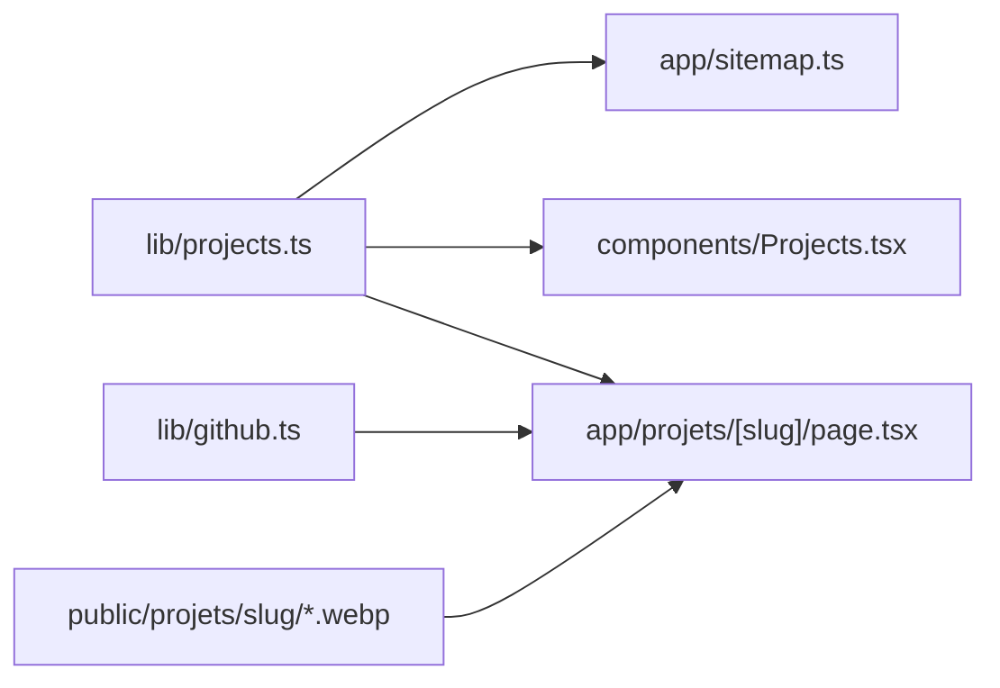

# Pages dédiées aux projets — design

Date : 2026-10-19

## Objectif

Donner à chaque projet de la section « Projets » une page de présentation propre, à mi-chemin entre vitrine produit et page indexable (SEO). Bénéfice secondaire : support de recrutement.

Critères de réussite :

- une URL indexable par projet, avec métadonnées, canonical et JSON-LD propres ;
- un contenu rédigé pour le portfolio (pas une copie du README) ;
- des données GitHub à jour sans maintenance manuelle ;
- aucune régression de l'accueil (navigation, ancres, cartes).

## Décisions

| Sujet | Décision |
|---|---|
| Source du contenu | Hybride : contenu vitrine rédigé dans le dépôt + données GitHub dynamiques ; installation détaillée renvoyée au README |
| Format du contenu | Données TypeScript structurées, aucune nouvelle dépendance (pas de MDX) |
| Visuels | Captures quand le projet a une interface, sinon un bloc de configuration/console (`codeSample`) |
| Accueil | La carte mène à la page interne ; GitHub devient un lien secondaire |
| Page index `/projets` | Non (doublon de la section d'accueil avec 5 projets) |
| URL | `/projets/<slug>`, slug = nom du dépôt GitHub |

## Architecture



### `lib/projects.ts` (nouveau)

Seule source de vérité, importée via `@root/lib/projects`. Le type et le tableau quittent `components/Projects.tsx`.

```ts
interface Project {
  slug: string; // = nom du dépôt
  name: string;
  description: string; // carte d'accueil + meta description
  pitch: string; // accroche de la page
  tags: string[];
  repoUrl: string;
  features: { title: string; description: string }[];
  screenshots?: { light: string; dark: string; alt: string }[];
  codeSample?: { language: string; code: string };
}
```

Chaque projet a soit `screenshots`, soit `codeSample` (au moins l'un des deux). L'ordre du tableau définit l'ordre de la grille d'accueil et de la navigation précédent/suivant.

### `lib/github.ts` (nouveau)

`getRepoStats(repoUrl): Promise<RepoStats | null>`

- appelle l'API REST publique `GET /repos/{owner}/{repo}` et `GET /repos/{owner}/{repo}/releases/latest` ;
- `fetch(..., { next: { revalidate: 86400 } })` (modèle de cache actuel, `cacheComponents` non activé) ;
- retourne `{ stars, license, pushedAt, latestRelease? }` ; `latestRelease` absent si le dépôt n'a pas de release (404) ;
- retourne `null` si l'appel au dépôt échoue (réseau, quota, statut non-2xx) : la page masque alors le bloc GitHub, aucune valeur inventée.

Volume : 2 appels par projet et par jour, très en dessous de la limite non authentifiée (60/h).

### `app/projets/[slug]/page.tsx` (nouveau)

- `generateStaticParams` depuis `lib/projects.ts` ; `dynamicParams = false` → slug inconnu = 404 existante (`app/not-found.tsx`).
- `generateMetadata` (voir SEO).
- Rendu serveur, données GitHub récupérées dans la page.

## Page projet

Direction « Vitrine » (révision du 19 oct. 2026, la première version jugée trop fade). Ordre des blocs :

1. `Navigation` partagée, `ScrollProgress`.
2. En-tête en deux colonnes, dans le halo miel du Hero de l'accueil :
   - à gauche : fil d'Ariane visible `<nav aria-label="Fil d'Ariane">` « Accueil › <nom> » (identique au JSON-LD), `h1`, pitch, tags, CTA « Voir sur GitHub », bloc GitHub (release, étoiles, licence, date de mise à jour) masqué si `null` ;
   - à droite, légèrement inclinée sur grand écran : première capture 16:10 via `next/image`, clair/sombre basculés en CSS (`dark:hidden` / `hidden dark:block`). Deux variantes : pas de `preload` (les deux seraient téléchargées), lazy-loading + `fetchPriority="high"` (doc Next `image.md`, « Theme detection ») ; image unique (`light === dark`) : `preload`. Sans capture : `codeSample` dans un `<pre>`.
3. Bandeau pleine largeur des chiffres clés (`stats`, 3 ou 4 valeurs réelles tirées des dépôts).
4. « Comment fonctionne <nom> » : frise d'étapes numérotées (`steps`, une vraie séquence), horizontale en `lg`, verticale en mobile. Titre remplaçable par `stepsHeading` quand la séquence ne décrit pas le fonctionnement (btop : « Comment le plugin se met à jour »).
5. « Points forts de <nom> » (`features`) : liste en 2 colonnes, sans cartes.
6. Galerie : captures suivantes, si plus d'une.
7. « Choix techniques de <nom> » (`stack`) : techno et raison du choix. Élision « d'<nom> » devant voyelle.
8. « Installation rapide » (`install`), bandeau pleine largeur, adaptée au projet : étapes numérotées, CTA éventuel (HACS), snippets réellement utilisables avec bouton copier (`components/CopyButton.tsx`), lien vers le README.
9. Navigation précédent/suivant : deux cartes compactes, ordre du tableau, circulaire.
10. `Footer` partagé.

Réutilise `Navigation`, `Footer`, `ScrollProgress` et les jetons de `globals.css`. Seule animation : l'entrée du Hero (classes `reveal` / `reveal-photo` de l'accueil) ; les sections suivantes s'affichent sans animation. Le visuel du Hero est une capture recadrée sur la zone utile, la capture entière va en galerie. Si cette direction ne convient toujours pas, piste suivante : une teinte par projet sur la même structure.

## SEO

- `generateMetadata` :
  - `title` : `seoTitle` du projet (≤ 60 caractères, contient le terme recherché, ex. « Ravelli Smart Wi-Fi : intégration Home Assistant locale ») ; le nom de l'auteur reste dans `og:site_name` et le JSON-LD ;
  - `description` : `description` du projet, 140 à 155 caractères (aussi texte de la carte d'accueil) ;
  - `alternates.canonical` : `/projets/<slug>` (obligatoire : le layout déclare `canonical: '/'` pour tout le site) ;
  - `openGraph` complet (`type: 'website'`, `siteName`, `locale`, `url`, `title`, `description`, `images`) car Next remplace l'objet du layout au lieu de le fusionner (le layout déclare `type: 'profile'`) ; image = première capture claire, sinon `/photo.webp` du layout ;
  - `twitter` complet (`card`, `title`, `description`, `images`) pour la même raison : le layout fixe titre, description et photo de l'accueil. `card: 'summary_large_image'` avec la première capture claire, sinon `card: 'summary'` avec `/photo.webp`.
- JSON-LD par page :
  - `SoftwareSourceCode` : `name`, `description`, `codeRepository`, `keywords` (tags), `programmingLanguage`, `license` (URL SPDX depuis GitHub, omise si indisponible), `author: { '@id': 'https://gauthierpainteaux.fr/#person' }`. Pas de `dateModified` : `pushed_at` du dépôt n'est pas une date éditoriale de la page ;
  - `BreadcrumbList` à deux niveaux : Accueil (`https://gauthierpainteaux.fr`) › projet (dernier élément sans `item`). Pas de niveau « Projets » : il n'existe pas de page `/projets`, et `/#projets` se confond avec l'accueil pour Google.
- `app/sitemap.ts` : ajoute une entrée par projet depuis `lib/projects.ts`.

## Changements sur l'existant

- `components/Projects.tsx` : importe les données ; la carte cesse d'être un `<Link>` global (pas de lien dans un lien). Le titre porte le lien interne `/projets/<slug>` étendu à toute la carte (`after:absolute after:inset-0`) ; le lien `Greite/<repo>` passe au-dessus (`relative z-10`) et ouvre GitHub dans un nouvel onglet. `LuArrowUpRight` remplacé par une flèche interne. Survol et zone cliquable inchangés. Carte « Tous mes projets » inchangée.
- `components/Navigation.tsx`, `components/Footer.tsx` : ancres `#…` → `/#…` pour fonctionner hors de l'accueil ; vérifier la logique « section active » de `Navigation` sur une page projet.
- `README.md` : mettre à jour la section « Structure du projet » si elle décrit l'emplacement du contenu des projets.

## Captures

- Prises pendant l'implémentation, navigateur piloté, l'utilisateur se connectant lui-même aux interfaces protégées ; aucun identifiant échangé ni commité.
- WebP 16:10 dans `public/projets/<slug>/`, versions claire et sombre quand l'outil propose les deux sans toucher aux réglages de l'utilisateur ; sinon une seule image (`light === dark`). Unraid et Home Assistant : une seule version, changer leur thème modifierait la configuration des serveurs.
- Dépôt public : chaque image est contrôlée avant commit. Aucun nom de machine, IP privée, domaine interne, nom de conteneur tiers ni prénom ; recadrage ou masquage sinon, signalé à l'utilisateur.
- Projets sans interface : `codeSample` tiré de la configuration ou des logs, valeurs réelles remplacées par des valeurs neutres (ex. `app-db`).

## Hors périmètre

- Coloration syntaxique (dépendance) : à ajouter si les blocs de code paraissent trop bruts.
- Lightbox sur les captures.
- Page index `/projets` : à ajouter quand la liste aura grandi.
- Données GitHub authentifiées.

## Vérification

Le dépôt n'a pas de suite de tests ; pas de test permanent ajouté pour du rendu statique.

- `bun run lint` (seul contrôle de types, le build ignore les erreurs TS).
- `bun run build` : les 5 pages projet sont prérendues (SSG).
- Navigateur sur le serveur de dev :
  - chaque page en clair, sombre et mobile ;
  - liens `/#…` depuis une page projet, état actif de la navigation ;
  - 404 sur slug inconnu ;
  - précédent/suivant, y compris le bouclage ;
  - bloc GitHub masqué si l'API échoue (faux dépôt temporaire, annulé ensuite) ;
  - JSON-LD bien formé, fil visible identique au `BreadcrumbList` ;
  - cartes d'accueil : lien interne et lien GitHub secondaire indépendants, focus clavier visible.
