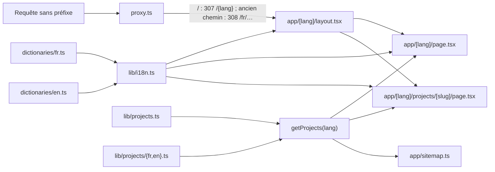

# Internationalisation FR / EN — design

Date : 2026-10-20

## Objectif

Proposer tout le portfolio en français et en anglais, pour toucher un public non francophone (recruteurs à l'étranger, visiteurs venus de GitHub) avec les mêmes objectifs que les pages projet : vitrine, SEO, recrutement.

Critères de réussite :
- chaque page existe en `/fr/...` et `/en/...`, rendue en statique ;
- l'intégralité du contenu est traduite : interface, accueil, expériences, formations, pages projet, métadonnées, JSON-LD ;
- une clé ou un projet non traduit casse `bun run lint` ;
- les anciennes URLs (françaises) redirigent en 308 vers leur équivalent `/fr` ;
- `hreflang`, canonical, `og:locale` et sitemap déclarent les deux langues ;
- aucune dépendance ajoutée.

## Décisions

| Sujet                           | Décision                                                                                                                                                                                                                      |
| ------------------------------- | ----------------------------------------------------------------------------------------------------------------------------------------------------------------------------------------------------------------------------- |
| URLs                            | Les deux langues préfixées : `/fr`, `/en`                                                                                                                                                                                     |
| Racine `/`                      | 307 selon `Accept-Language` : `fr` si le navigateur préfère le français, sinon `en`. Pas de 308 : la cible dépend du visiteur                                                                                                 |
| Autres URLs sans préfixe        | Anciennes URLs, uniquement françaises : 308 vers `/fr/…` (`/projets/<slug>` → `/fr/projects/<slug>`). `/<lang>/projects` (pas d'index) → ancre Projets                                                                        |
| Langue par défaut / `x-default` | `en` ; `x-default` de l'accueil = `/` (racine qui redirige selon la langue, schéma documenté par Google)                                                                                                                      |
| Segment des pages projet        | `/projects/<slug>` dans les deux langues (`/projets/<slug>` redirige)                                                                                                                                                         |
| Slugs                           | Identiques dans les deux langues (nom du dépôt GitHub)                                                                                                                                                                        |
| Mécanisme                       | Natif Next 16 : `app/[lang]`, `proxy.ts`, `next/root-params` ; pas de `next-intl`                                                                                                                                             |
| Format des traductions          | Dictionnaires TypeScript (`en` typé par `fr`), fonctions autorisées pour les cas variables                                                                                                                                    |
| Mémorisation du choix           | Aucune (pas de cookie) : la langue est dans l'URL                                                                                                                                                                             |
| Ancres de section               | Traduites, dans `sectionIds` (`lib/locales.ts`) : `#a-propos`, `#experience`, `#projets`, `#formations` en FR ; `#about`, `#experience`, `#projects`, `#education` en EN. Le sélecteur de langue conserve la section en cours |
| Rédaction EN                    | Adaptation par Claude, relue par Gauthier avant release                                                                                                                                                                       |

## Architecture



### Arborescence `app/`

```
app/
  [lang]/
    layout.tsx          root layout : <html lang>, generateStaticParams (fr, en), dynamicParams = false
    page.tsx
    not-found.tsx
    error.tsx
    projects/[slug]/page.tsx
  api/health/route.ts   inchangé
  sitemap.ts  robots.ts  icon.png  apple-icon.png  favicon.ico  globals.css
```

`app/layout.tsx`, `app/page.tsx`, `app/not-found.tsx`, `app/error.tsx` et `app/projets/` disparaissent (déplacés sous `[lang]`). Les captures restent dans `public/projets/<slug>/` : ce sont des fichiers, pas des routes.

Pages générées : `/fr`, `/en` et 5 projets × 2 langues, soit 12 pages statiques. `/en/inconnu` ou `/fr/projects/inconnu` renvoient la 404 localisée ; `/de` n'a pas de préfixe de langue, il est donc redirigé vers `/en/de`, qui renvoie la 404.

### `proxy.ts`

- Matcher : tout sauf `_next`, `api` et les chemins contenant un point (`sitemap.xml`, `robots.txt`, icônes, `public/`).
- Chemin déjà préfixé par `fr` ou `en` : laissé passer.
- Sinon :
  1. `/` : langue = `fr` si la meilleure qualité d'une variante `fr` (`fr`, `fr-FR`…) dépasse celle d'une variante `en` (absente = 0 ; à qualité égale, la première citée gagne), sinon `en`. Exemples : `fr-FR,en;q=0.8` → fr ; `de,fr;q=0.5` → fr ; `en,fr` → en ; `de` ou absent → en. Réponse 307, en-têtes `Vary: Accept-Language` et `Cache-Control: private, no-store` ;
  2. autre chemin sans langue : 308 vers `/fr{chemin}`, avec `/projets/` réécrit en `/projects/` ; query string conservée ;
  3. chemin préfixé : `/<lang>/projets/…` → `/<lang>/projects/…` et `/<lang>/projects` → `/<lang>#<ancre Projets>`, en 308.
- La logique est une fonction pure, `redirectFor(pathname, acceptLanguage)`, dans `lib/locales.ts` avec `preferredLocale`, `locales`, `Locale`, `defaultLocale`, `hasLocale`, `sectionIds` et `switchLocalePath`. Ce fichier n'importe pas `next/root-params`, pour rester utilisable dans le proxy et les composants client. Il est couvert par `lib/locales.check.ts` (asserts `node:assert`, lancé avec `bun lib/locales.check.ts`).

### `lib/i18n.ts`

```ts
import { type Locale } from '@root/lib/locales'; // locales, Locale, defaultLocale, hasLocale vivent dans lib/locales.ts
export async function getDictionary(): Promise<Dictionary>; // lit next/root-params, notFound() si inconnue
export function alternates(lang: Locale, path: string): Metadata['alternates']; // canonical + languages fr/en/x-default
```

`path` est le chemin sans préfixe (`''`, `/projects/<slug>`).

### Dictionnaires

- `dictionaries/fr.ts` : `export const fr = { … }` puis `export type Dictionary = typeof fr`.
- `dictionaries/en.ts` : `export const en: Dictionary = { … }`.
- Contenu : navigation et sélecteur de langue, Hero, À propos et compétences, expériences, formations, footer, 404, page d'erreur, libellés des pages projet (titres de section, boutons, aria-labels, bloc GitHub), metadata du site, textes des JSON-LD (`jobTitle`, descriptions). Pas de FAQ JSON-LD (supprimée : Google n'affiche plus ces résultats, et le contenu n'était pas visible).
- Valeurs variables via des fonctions, par exemple `duration(years: number, months: number): string`.

### Projets

- `lib/projects.ts` garde la partie qui ne dépend pas de la langue : `slug`, `name`, `repoUrl`, `tags`, `programmingLanguage`, chemins `light`/`dark` des captures, `codeSample`.
- `lib/projects/fr.ts` et `lib/projects/en.ts` : `Record<Slug, ProjectText>`, avec `ProjectText` = `description`, `seoTitle`, `pitch`, `stats`, `steps`, `stepsHeading?`, `features`, `stack`, `install`, `alt` des captures (dans l'ordre des captures). `Slug` est dérivé des slugs de base : un projet sans traduction est une erreur de type.
- `getProjects(lang)`, `getProject(slug, lang)`, `getAdjacentProjects(slug, lang)` renvoient le `Project` fusionné ; la forme de `Project` vue par les composants ne change pas.
- Les contraintes SEO existantes s'appliquent aux deux langues : `seoTitle` ≤ 60 caractères, `description` de 140 à 155 caractères.

### Composants

- Composants serveur (`Hero`, `AboutSkills`, `Experience`, `Formations`, `Projects`, `Footer`) : lisent le dictionnaire via `getDictionary()` (ou le reçoivent en props s'ils restent synchrones).
- Composants client (`Navigation`, `CopyEmail`, `CopyButton`, `ThemeToggle`, `BackToTop`) : libellés et `lang` passés en props par le parent serveur ; aucun dictionnaire dans le bundle client.
- `[lang]/error.tsx` est un Error Boundary client sans props : il lit la langue avec `useParams()` et importe uniquement ses libellés depuis `dictionaries/error.ts` (`{ fr: {…}, en: {…} }`, quelques chaînes), pas le dictionnaire complet. `[lang]/not-found.tsx` reste un composant serveur et utilise `getDictionary()`.
- Sélecteur de langue dans `Navigation` (barre desktop et menu mobile) : lien vers le même chemin dans l'autre langue, `hrefLang` et `lang` sur le lien.
- Dates affichées (bloc GitHub) : `toLocaleDateString(lang)`.

### SEO

- Par page : `alternates.canonical` = l'URL elle-même, `alternates.languages` = `fr`, `en`, `x-default` → version `en`.
- `openGraph.locale` = `fr_FR` / `en_US`, `openGraph.alternateLocale` = l'autre.
- `sitemap.ts` : 12 entrées, chacune avec `alternates.languages`.
- JSON-LD de `[lang]/layout.tsx`, `[lang]/page.tsx` et des pages projet : textes issus du dictionnaire / de `ProjectText`, `inLanguage` renseigné.

## Vérification

- `bun run lint` (dont la complétude des traductions par `tsc`) et `bun run build` (12 pages statiques).
- Smoke test sur `bun run prod` avec `curl` :
  - `/` + `Accept-Language: fr-FR` → 307 `/fr` ; sans en-tête ou `de` → 307 `/en` ;
  - `/projets/speedtest-monitor` → 308 `/fr/projects/speedtest-monitor` ; `/en/projects` → 308 `/en#projects` ;
  - `/de` → 308 `/fr/de` → 404 ; `/en/inconnu`, `/fr/projects/inconnu` → 404 ;
  - `/sitemap.xml`, `/robots.txt`, `/api/health`, icônes, captures `/projets/<slug>/*.webp` → 200 sans redirection ;
  - sur une page : `<html lang>`, canonical, `hreflang` ×3, `og:locale`, JSON-LD en anglais sur `/en`.
- Navigateur : accueil et une page projet dans les deux langues, sélecteur FR/EN (desktop et mobile, chemin conservé), thèmes clair et sombre.
- Self-check du parsing `Accept-Language`.

## Documentation et livraison

- `README.md` et `.omp/AGENTS.md` : la section « Pièges » ne parle plus de contenu en dur dans `components/` mais des dictionnaires et de `lib/projects/{fr,en}.ts`, à faire évoluer ensemble, avec les JSON-LD.
- Branche `feat/i18n`, commits `Improve - #PRT-NoId - …`.
- Release mineure (4.15.0) après relecture de l'anglais.

## Hors périmètre

- Mémorisation du choix de langue (cookie).
- Traduction des segments d'URL.
- Langues supplémentaires.
